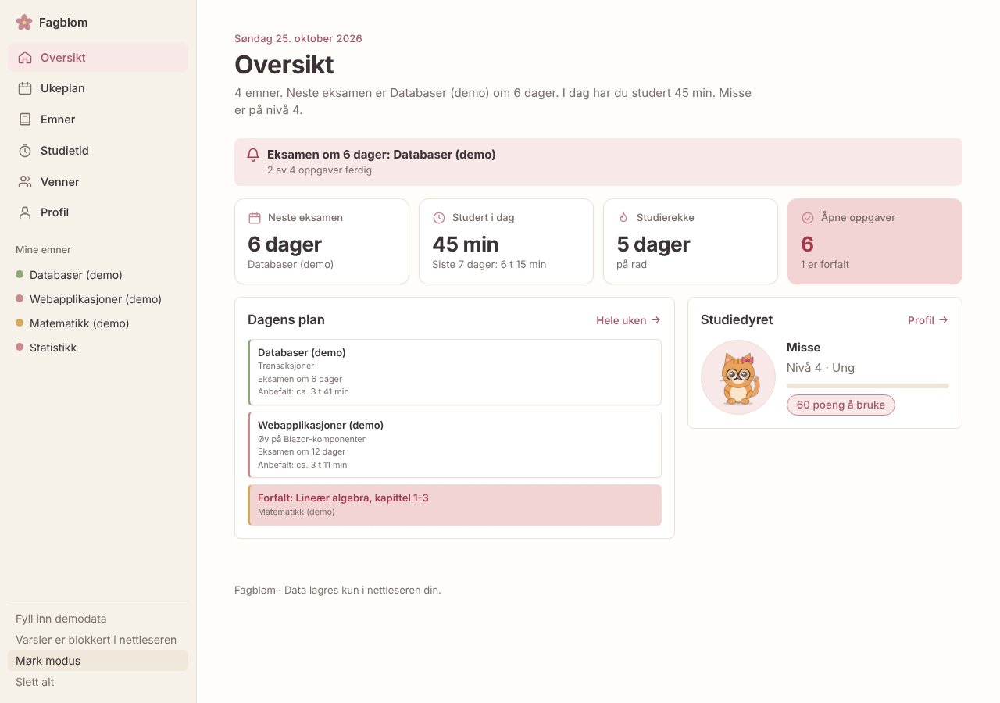
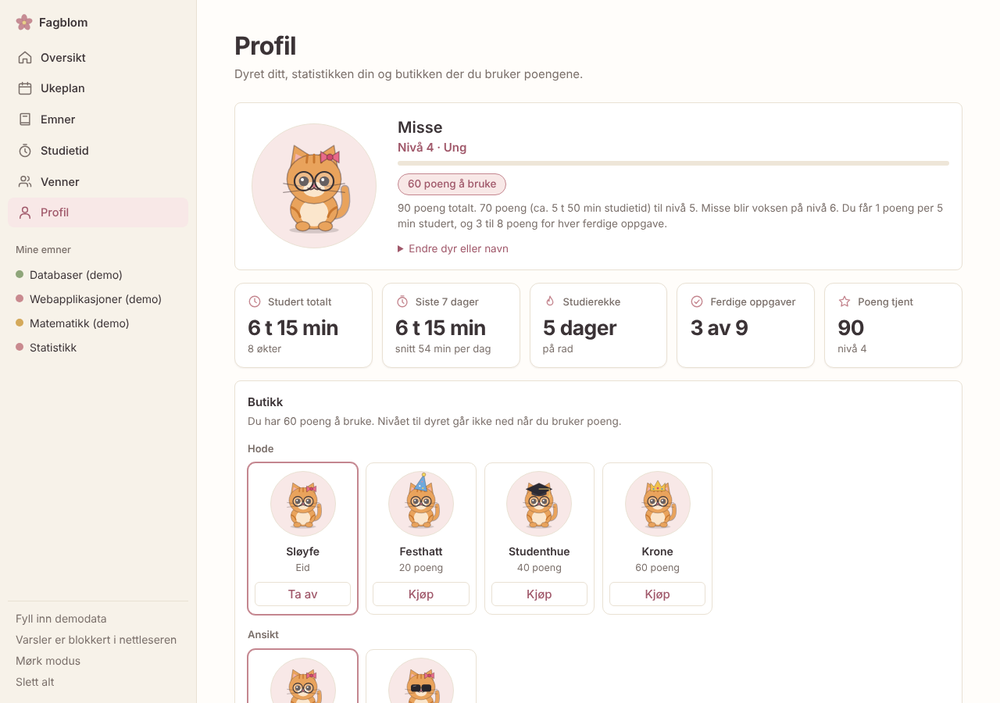
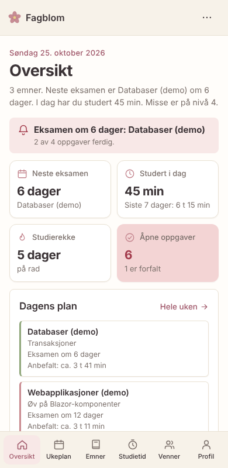

# Fagblom

**Fagblom** er en studieapp som hjelper meg å planlegge eksamenslesing, logge studietid og samle poeng til et studiedyr som vokser. Navnet kommer av «fag» (emnene) og «blom» (noe som vokser når man steller det). Den er laget med hjelp fra generativ AI (Claude) som «vibe coding»-oppgave ved OsloMet.

**Demo:** (https://sakha7445.github.io/fagblom/)

## Hva den gjør

Appen har seks sider: **Oversikt**, **Ukeplan**, **Emner**, **Studietid**, **Venner** og **Profil**. På mobil ligger menyen nederst, som i en vanlig app.

- **Oversikt:** dagens dato, nøkkeltall (neste eksamen, tid studert i dag, studierekke, åpne oppgaver), dagens plan og studiedyret. Når du ikke har lagt inn noe enda, får du en liten «Kom i gang»-guide.
- **Emner og eksamensdatoer** med nedtelling og varsel når eksamen nærmer seg (på siden, og som nettleservarsel hvis man tillater det).
- **Oppgaver per emne** med frist og prioritet (høy, middels, lav). Forfalte oppgaver og frister vises tydelig.
- **Ukeplan** for de neste 7 dagene. Planen velger hver dag de to emnene som haster mest, ut fra hvor mye som gjenstår, hvor nær eksamen er og om det finnes oppgaver med høy prioritet eller snart frist.
- **Mål per emne:** ønsket karakter og timemål, med hvor mye som er igjen og ca. hvor mange minutter per dag som trengs.
- **Studietid:** pomodoro-timer, manuell logging og oversikt over de siste 7 dagene per emne.
- **Profil:** studiedyret ditt, statistikk (tid totalt, siste 7 dager, studierekke, ferdige oppgaver, poeng), en butikk og sikkerhetskopi av dataene.
- **Studiedyr og butikk:** velg mellom åtte tegnede dyr (to katter, to hunder, rev, pingvin, panda og kanin). Dyret starter som baby og blir ung, voksen og til slutt gammel og klok jo mer du studerer. Du får poeng for studietid (1 poeng per 5 minutter) og for hver ferdige oppgave (3 til 8 poeng etter prioritet). Poengene bruker du i en butikk på tilbehør (sløyfe, hatter, briller, skjerf, flue) og bakgrunner (eng, natthimmel, solnedgang). Nivået går ikke ned når du bruker poeng.
- **Venner (demo):** en toppliste over hvem som har studert mest siste 7 dager, eller har høyest nivå. Vennene er oppdiktet og tydelig merket «Demo», mens tallene dine er ekte. Å ha ekte venner krever en server med innlogging, og det er ikke med i denne versjonen.
- **Sikkerhetskopi:** last ned og importer data som JSON, og legg eksamener og frister i kalenderen som `.ics`-fil.
- **Mørk modus**, tastaturnavigasjon og layout som fungerer på mobil.

Alt lagres kun i nettleseren (localStorage). Det finnes ingen server, ingen innlogging og ingen personopplysninger sendes noe sted.

## Hvordan åpne den

Åpne demo-lenken øverst. Du kan også laste ned repoet og dobbeltklikke på `index.html`. Hele appen ligger i denne ene filen (HTML, CSS og JavaScript). Skrifttypen Inter hentes fra Google Fonts hvis man er på nett; uten nett brukes systemfonten.

## Tester

Appen er testet på to måter:

- `tests/app.test.js` kjører appen i en simulert nettleser (jsdom) og sjekker blant annet datavalidering, sidene og menyen, oppgavesortering, ukeplan, timemål, timer (start, pause, ferdig, gjenopptak etter ny innlasting), poeng, nivåer og butikk, studierekke, topplisten, eksport/import, kalenderfilen og mørk modus. Kjør med `npm install jsdom` og deretter `node tests/app.test.js`.
- Manuell og automatisk prøving i ekte nettleser (Chromium) på skjermbredder fra 360 til 1280 px, for å sjekke at siden ikke kan scrolles sidelengs, at nedlasting og import av filer fungerer, og at det ikke dukker opp feil i konsollen. Bildene i `screenshots/` er tatt slik.

## Skjermbilder

## Bruk av AI og testing

Se `AI-LOGG.md` for hvordan AI ble brukt, hva som ble endret underveis og hva som ble testet.

## Personvern

Ingen passord, API-nøkler eller personopplysninger ligger i koden. Demodataene i appen er oppdiktet og er merket «(demo)».
